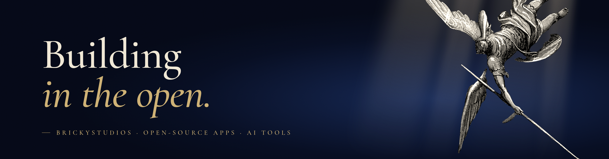

<strong>Open-source Android and web apps, Claude skills and self-hosted tools. Small, offline where possible, no accounts.</strong>

  

  
  
  

## Projects

| | |
|---|---|
| **[Unreplied](https://github.com/BrickyStudios/unreplied)** · Android | ADHD texting app that reminds you to text back: tracks WhatsApp, Signal, Telegram and SMS chats you read but never answered, reply sprint with quick replies. No internet permission. [Website](https://brickystudios.github.io/unreplied/) · [Download APK](https://github.com/BrickyStudios/unreplied/releases/latest/download/Unreplied.apk) |
| **[Funkblick](https://github.com/BrickyStudios/funkblick)** · Android | Passive Wi-Fi and Bluetooth scanner for Android and GrapheneOS: AirTag tracker alerts, hidden camera finder, car mode with speed camera warnings. [Website](https://brickystudios.github.io/funkblick/) · [Download APK](https://github.com/BrickyStudios/funkblick/releases/latest/download/Funkblick.apk) |
| **[FitShare](https://github.com/BrickyStudios/FitShare)** · Android + web | Turns Mi Fitness, Garmin Connect, Strava or Gadgetbridge workouts into transparent Instagram story stickers. Offline, no account. [Website](https://brickystudios.github.io/FitShare/) · [Download APK](https://github.com/BrickyStudios/FitShare/releases/latest/download/FitShare.apk) |
| **[Monatskasse](https://github.com/BrickyStudios/monatskasse)** · Android + web | Pocket-money app and budget book without an account: log expenses, scan receipts, export to Excel. In German. [Website](https://brickystudios.github.io/monatskasse/) · [Download APK](https://github.com/BrickyStudios/monatskasse/releases/latest/download/Monatskasse.apk) |
| **[Passwerk](https://github.com/BrickyStudios/digitaler-produktpass)** · Web | Source-available generator for EU digital product passports and battery passports: one JSON file per product, passport pages with GS1 QR codes on GitHub Pages. [Website: Digitaler Produktpass](https://brickystudios.github.io/digitaler-produktpass/) · [Battery passport guide](https://brickystudios.github.io/digitaler-produktpass/en/battery-passport/) |
| **[AI Fact Checker](https://github.com/BrickyStudios/ai-fact-checker-claude-skill)** · Claude skill | Checks reports, PDFs and AI drafts claim by claim and proves quotes and numbers with a script. |
| **[Strava Dashboard](https://github.com/BrickyStudios/strava-dashboard)** · Python | Self-hosted Strava dashboard with activity grades, route maps and AI coaching notes. Demo mode, no account needed. |

## Activity

  

<picture>
  <source media="(prefers-color-scheme: dark)" srcset="https://raw.githubusercontent.com/BrickyStudios/BrickyStudios/output/snake-dark.svg">
  
</picture>

Banner and avatar: engraving of a falling angel by Gustave Doré (1832–1883), public domain.

